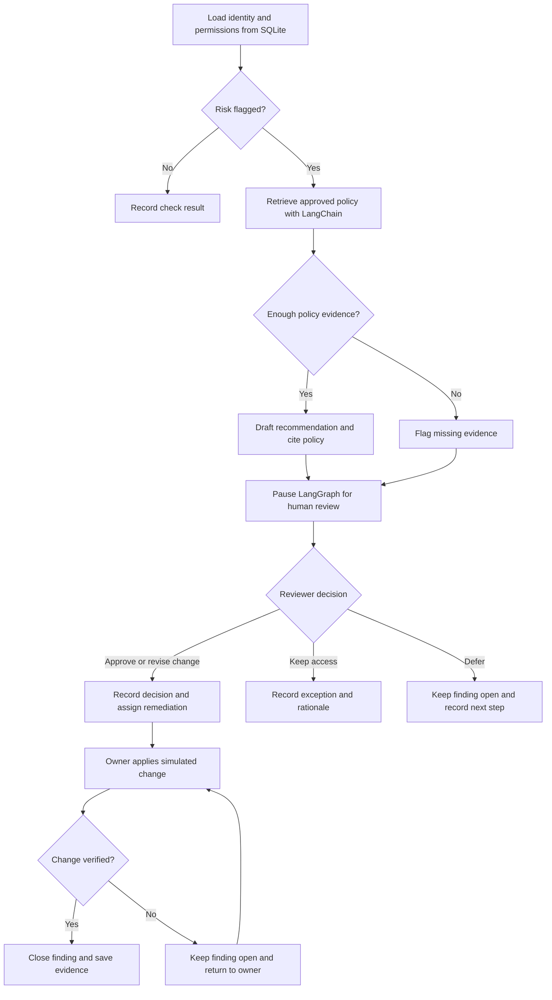

# Non-Human Identity Access
AI-assisted access reviews for service accounts and AI agents, with policy citations and human approval.

# Non-Human Identity Access Review Assistant

A portfolio project that helps security reviewers identify and resolve access risks for service accounts and AI agents. The first version uses synthetic data and simulates permission changes.

## Workflow

## Component responsibilities

| Component | Responsibility |
|---|---|
| Python | Flag missing owners, stale credentials, and permissions beyond the approved role baseline. |
| SQLite | Store synthetic identities, permissions, findings, review decisions, and verification evidence. |
| LangChain and the LLM | Retrieve approved policy and draft a recommendation with a citation. Surface any evidence gaps. |
| LangGraph | Route findings, pause for a human decision, and resume the workflow after review. |
| Streamlit | Display findings and evidence, capture decisions and rationale, and show remediation status. |

## Demo and evaluation

| Scenario | Expected result |
|---|---|
| A support-ticket agent has `tickets:read` and `tickets:write`, but its approved role allows only `tickets:read`. | The assistant cites the approved policy and recommends removing write access. After human approval, the finding closes only when the simulated inventory confirms the permission was removed. |
| The approved policy is unavailable. | The assistant reports insufficient policy evidence and routes the finding to a human reviewer. The audit history captures the evidence gap and the reviewer’s decision. |
